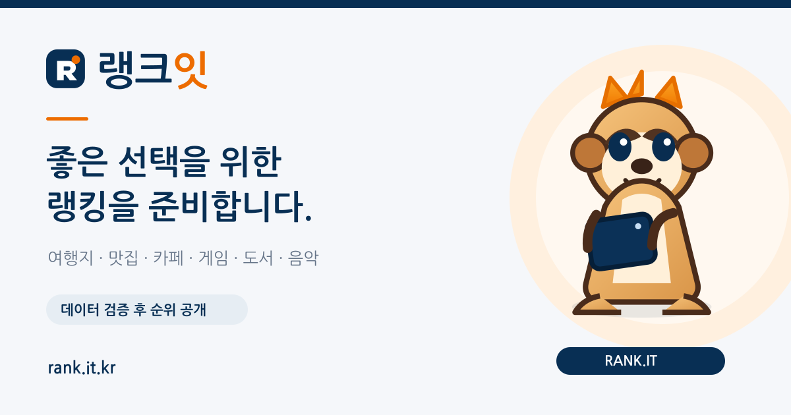

# 랭크잇 링크 공유 미리보기

## 범위와 변경 전 상태

기준 커밋: `41e55fe2b84765e9a75f61eb0e14ed9e23f59842`.
홈페이지와 여행지·맛집·카페·게임·도서·음악·랭킹 기준, 총 8개 페이지를 확인했습니다.

| 항목 | 변경 전 | 변경 후 |
| --- | --- | --- |
| 홈페이지 Open Graph | 제목·설명·주소·유형 4개 | 이미지·크기·대체문구·사이트명·언어 등을 포함한 12개 |
| 하위 7개 페이지 Open Graph | 없음 | 각 페이지에 12개 |
| X(Twitter) 카드 | 전체 없음 | 각 페이지에 큰 이미지 카드·제목·설명·이미지·대체문구 5개 |
| 공유 이미지 | 없음 | 동일한 1200×630 PNG |
| 기본 제목·설명 | 일부 문구가 현재 순위를 제공하는 것으로 읽힐 수 있음 | 준비 상태와 검증 후 공개 원칙 명시 |
| canonical | 8개 모두 존재 | 기존 HTTPS 주소와 끝 슬래시 유지, `og:url`과 일치 |

8개 페이지 모두 실제 HTML의 `<head>`에 태그를 넣었습니다. 공유 정보 수집에
브라우저 JavaScript 실행이나 새 서버/API가 필요하지 않습니다.
`twitter:site`, `twitter:creator`, Facebook 앱 ID는 확인된 계정이 없어 임의로 추가하지 않았습니다.
404 페이지는 정상 콘텐츠 공유 페이지가 아니므로 변경 대상에 포함하지 않았습니다.

## 페이지별 문구

아래 제목·설명을 각각 기본 HTML, Open Graph, X 카드에 동일하게 사용합니다.
홈페이지 WebSite JSON-LD 설명도 같은 준비 상태로 맞췄습니다.

| 경로 | 제목 | 설명 |
| --- | --- | --- |
| `/` | 랭크잇 \| 분야별 랭킹 준비 중 | 여행지·맛집·카페·게임·도서·음악 랭킹을 준비하는 랭크잇입니다. 실제 순위는 데이터 출처와 산정 기준 검증 후 공개합니다. |
| `/travel/` | 여행지 랭킹 준비 중 \| 랭크잇 | 대한민국 여행지 TOP 500과 지역별 탐색을 준비하고 있습니다. 실제 순위는 데이터 출처와 산정 기준 검증 후 공개합니다. |
| `/food/` | 맛집 랭킹 준비 중 \| 랭크잇 | 전국 맛집을 지역과 음식 종류별로 살펴볼 수 있는 랭킹을 준비하고 있습니다. 실제 순위는 데이터 검증 후 공개합니다. |
| `/cafe/` | 카페 랭킹 준비 중 \| 랭크잇 | 전국 카페를 지역과 유형별로 살펴볼 수 있는 랭킹을 준비하고 있습니다. 실제 순위는 데이터 검증 후 공개합니다. |
| `/game/` | 게임 랭킹 준비 중 \| 랭크잇 | PC·콘솔·모바일의 플랫폼과 장르를 구분한 게임 랭킹을 준비하고 있습니다. 실제 순위는 데이터 검증 후 공개합니다. |
| `/book/` | 월간 도서 랭킹 준비 중 \| 랭크잇 | 판매·대출·관심도를 구분해 살펴보는 월간 도서 랭킹을 준비하고 있습니다. 실제 순위는 데이터 검증 후 공개합니다. |
| `/music/` | 월간 음악 랭킹 준비 중 \| 랭크잇 | 월간 흐름과 장르별 특성을 살펴보는 음악 랭킹을 준비하고 있습니다. 실제 순위는 데이터 검증 후 공개합니다. |
| `/methodology/` | 랭킹 산정 원칙 \| 랭크잇 | 분야별 데이터 선정, 표본 보정, 광고와 순위 분리 등 랭크잇이 준비하는 랭킹 산정 원칙을 안내합니다. |

## 공통 이미지



- 배포 경로: `https://rank.it.kr/assets/rankit-share-v1.png`
- PNG, 1200×630 픽셀, 70,329바이트(약 68.7 KiB).
- 기존 `favicon.svg`, `mascot.svg`와 남색 `#082f54`, 주황색 `#ed6c00`을 활용했습니다.
- 문구는 “랭킹을 준비합니다”, “데이터 검증 후 순위 공개”이며 가상 순위·점수·통계를 넣지 않았습니다.
- 편집 원본 `design/rankit-share.svg`에는 마스코트와 로고를 내장했습니다.
  텍스트는 [Nanum Gothic](https://github.com/google/fonts/tree/main/ofl/nanumgothic) Regular/Bold를 사용합니다.
  원본 편집·재출력 시 해당 글꼴을 설치하고 1200×630 PNG로 내보내세요.
  배포된 PNG는 외부 글꼴이나 이미지 서버에 의존하지 않습니다.
- 이미지 교체 시 `rankit-share-v2.png`처럼 새 파일명을 사용하고, 8개 페이지의
  `og:image`, `og:image:secure_url`, `twitter:image`와 크기·대체문구를 함께 갱신하세요.

## 검증과 배포

```sh
npm run check:social
```

검증 스크립트는 모든 `public/**/index.html`을 찾아 제목·설명의 페이지별 고유성,
필수 태그·중복·빈 값, canonical과 OG 주소 일치, HTTPS 이미지 경로,
PNG 시그니처·실제 크기·파일 크기, 사이트맵의 페이지 누락 여부를 확인합니다.

HTTP 응답도 검사하려면 실행 중인 로컬 서버 또는 배포 주소를 지정하세요.
`Twitterbot/1.0` User-Agent로 요청하여 HTML/PNG의 HTTP 200, Content-Type,
X-Robots-Tag와 실제 메타태그·이미지 바이트가 로컬 파일과 일치하는지 검사합니다.

```sh
# 기존 Cloudflare 로컬 환경
npm run dev -- --local --port 8787
npm run check:social -- --base-url http://127.0.0.1:8787

# 변경 사항 반영 후, 기존 Cloudflare 운영 환경에 배포
npm run deploy

# 배포 완료 후 운영 주소 확인
npm run check:social -- --base-url https://rank.it.kr
```

`wrangler.jsonc`, 정적 루트 `public/`, Workers Static Assets 운영 방식을 유지했습니다.
HTML의 `<body>` 이후 본문, 기존 CSS·JS, robots.txt, sitemap.xml, 404 페이지는
기준 커밋과 바이트 단위로 동일합니다. 새 런타임 의존성이나 빌드 과정은 추가하지 않았습니다.

### 완료한 검증

- `npm run check:social`: 8개 페이지 통과.
- 로컬 정적 HTTP 서버 + `--base-url http://127.0.0.1:8788`: 8개 HTML과 PNG 모두
  HTTP 200, Content-Type 및 메타태그·이미지 바이트 일치 확인.
- Wrangler 4.149.0 `deploy --dry-run`: 정적 자산 읽기와 배포 준비 통과. 실제 업로드·배포 없음.
- 기존 8개 본문과 CSS·JS·Cloudflare 설정·robots.txt·sitemap.xml·404 파일 비교: 변경 없음.
- PNG 디코딩과 육안 확인: 한글 표시, 마스코트, 여백과 문구 잘림 없음.
- `git diff --check`: 통과.

### 운영 반영 후 확인할 항목

이 실행 환경에서 `wrangler dev`는 `uv_interface_addresses` 시스템 오류로 시작하지 못했습니다.
따라서 HTTP 검사는 일반 정적 서버로 수행했으며, Cloudflare 로컬 에뮬레이터에서의
실행·리다이렉트 동작을 확인한 것으로 해석하면 안 됩니다. 배포 준비 검사는 별도로 통과했습니다.

GitHub 변경 사항 준비와 실제 Cloudflare 운영 배포는 별개입니다.
실제 서비스 배포 및 카카오톡·Facebook·X의 공유 화면은 아직 검증하지 않았습니다.
배포 후 위 운영 주소 검사를 실행하고 각 서비스에서 링크를 다시 공유해 확인하세요.
기존 공유 링크는 서비스별 캐시가 남을 수 있으므로 필요한 경우 해당 서비스의
공유 디버거에서 URL을 다시 수집하세요. 플랫폼별 자르기와 설명 표시 방식은 다를 수 있습니다.

## 참고 규격

- [Open Graph protocol](https://ogp.me/): 기본 속성, locale, site_name, 이미지 크기·유형·alt.
- [Cloudflare HTML handling](https://developers.cloudflare.com/workers/static-assets/routing/advanced/html-handling/):
  디렉터리의 index.html에 사용하는 기본 끝 슬래시 동작.
